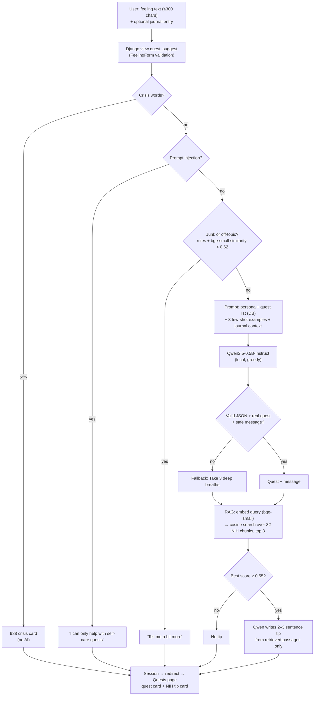

# P1-A9 - Part 2: AI System Design Documentation

**Feature:** Feature: "Ask SafeSpace" on the Quests page. A user writes how they feel and the LLM pulls from their 3 most recent journal entries. SafeSpace then:
1. Picks one quest from our database that fits the feeling, paired with a short, kind message.
2. Adds a health tip based on NIH articles, complete with direct links to the sources via retrieval-augmented generation (RAG).

Everything operates locally using two open-source Hugging Face models. No user text is sent to an external API.

| Code / File Path | What it does |
| :--- | :--- |
| `safespace/core/views.py` → `quest_suggest()` | The Django view: validates the form, calls the AI pipeline, saves the result to the session, and redirects. |
| `safespace/core/ai.py` | Quest suggestion engine: handles preprocessing, guardrails, prompt assembly, model inference, and output checks. |
| `safespace/core/rag.py` | Health tip engine: manages RAG chunking, embeddings, vector search, and the "is this about feelings?" relevance check. |
| `safespace/core/data/knowledge_base.txt` | The knowledge base containing 6 NIH / NIMH self-care articles. |
| `llm-test/relevance_check.py` | Script documenting how the semantic relevance threshold was selected and validated. |

---

## Step 2.1: AI Workflow Write-Up

### 1. What user input enters the AI system

The **Ask SafeSpace** form (`FeelingForm`) on the Quests page has two fields. At least one is required:

- **"How are you feeling today?"**: Free text, limited to **up to 300 characters** (enforced in the HTML and again in Django form validation). Quick-feeling buttons on the page (e.g., *"I'm feeling stressed"*) auto-fill this input box.
- **"Base it on a journal entry"** (optional): A dropdown selector containing the user's **own** journal entries.
  - If selected, its overall message plus up to **400 characters** of the entry is included.
  - If not selected, short excerpts (**200 characters each**) of the user's **3 most recent entries** are included as background context.

The view loads the **26 solo quests** from the database (Together quests are excluded because they require a friend). The model can only select from these 26 available options.

> **Privacy & Security:** The form only accepts logged-in users and strictly filters dropdown options to their own journal entries, preventing one user's journal content from ever reaching the model for another user.

### 2. How the input is preprocessed

Before reaching the model, user input passes through a strict sequence of ordered checks. If any check fails, a fixed message is returned, and **the model is never called**:

| Pipeline Step | What Happens | Example Input | Resulting Action / Output |
| :--- | :--- | :--- | :--- |
| **1. Clean** | Remove control characters and extra spaces; truncate to 300 characters at a word boundary. | `"\t I'm\n\n tired "` | `"I'm tired"` → Continue |
| **2. Crisis Check** | Regex patterns for self-harm language (e.g., *"kill myself"*, *"want to die"*, *"self-harm"*). | `"I want to die"` | 988 Suicide & Crisis Lifeline message (no quest or tip generated). |
| **3. Injection Check** | Regex patterns for prompt injection attempts (e.g., *"ignore previous instructions"*, *"you are now"*, *"system prompt"*). | `"ignore all previous instructions"` | *"I can only help with self-care quests…"* |
| **4. Junk Rules** | Rejects non-letter strings, single repeated letters, keyboard mashing, or bare greetings. | `"???"`, `"asdf jkl"`, `"hello"` | *"I couldn't tell how you're feeling…"* |
| **5. Relevance Check** | Embed text with `bge-small` and calculate cosine similarity against 25 canonical feeling examples. Score **< 0.62** = off topic. | `"what is the capital of France"` | *"I couldn't tell how you're feeling…"* |

*Rules vs. Embeddings Rationale:*
- The **Crisis Check** intentionally uses deterministic keyword patterns. In A7 benchmarking, small models were unreliable at spotting crisis messages (`Qwen2.5-0.5B` labeled everything as a "crisis"), so this safety check does not depend on model inference.
- The **Relevance Check** relies on semantic meaning rather than fixed keywords (e.g., *"ugh mondays"* is recognized as a feeling, whereas *"how to make pancakes"* is recognized as off-topic).

### 3. What models are used

| Model | Size | Primary Job |
| :--- | :--- | :--- |
| [`Qwen/Qwen2.5-0.5B-Instruct`](https://huggingface.co/Qwen/Qwen2.5-0.5B-Instruct) | 0.49B parameters (~1 GB) | Picks the quest, writes the kind message, and synthesizes the health tip. |
| [`BAAI/bge-small-en-v1.5`](https://huggingface.co/BAAI/bge-small-en-v1.5) | 33M parameters (~130 MB) | Generates embeddings for RAG retrieval and the semantic relevance check. |

- Both models load lazily on the first request and remain cached in memory (`lru_cache`).
- They run on GPU acceleration (CUDA, or MPS on Apple Silicon) when available, falling back to CPU.
- Neither model was fine-tuned.

### 4. How output is generated

#### A) Quest Suggestion (`ai.py`)
The prompt uses a three-part chat format:
1. **System message (persona + rules):** *"You are SafeSpace, a brief, gentle and non-judgemental self-care assistant. Read how the user feels and choose ONE quest from this list: […]"*. The 26 quests are provided as JSON with title and category. Output is strictly forced to JSON: `{"quest": "<exact title>", "message": "<one short, kind sentence>"}`.
2. **3 few-shot examples:** Synthetic feeling prompts paired with valid JSON answers using real database quests (e.g., *"My mind is racing and I can't relax."* → `{"quest": "Take 3 deep breaths", "message": "Let yourself slow down for a moment."}`). A6 testing proved few-shot prompting was the most effective style for forcing format adherence on small models.
3. **User message:** `How I feel now: <text>`, plus chosen journal entry or 3 recent excerpts marked *"background only"*.

Qwen generates up to **120 new tokens** using **greedy decoding** (`do_sample=False`), ensuring deterministic, predictable, and testable outputs.

**Output Validation Checks:**
- **Valid JSON:** Extracts text between `{` and `}`, parsed via `json.loads`.
- **Real Quest Match:** Fuzzy match of title against database quests (`difflib`, cutoff `0.8`) to correct typos while rejecting hallucinated titles.
- **Safe Message Check:** Truncated to 250 characters; rejects blocked words (*"stupid"*, *"hate"*, *"lazy"*, *"drugs"*, etc.).

> **Fallback:** If any check fails, it defaults to the quest *"Take 3 deep breaths"* with message *"Try taking 3 deep breaths. Small steps still count."*

#### B) Health Tip (`rag.py`)
Executed only after a valid or fallback suggestion:
1. **Knowledge base:** 6 NIH / NIMH articles split into **32 chunks** using the A8 **hybrid strategy** (headers `##`, split at paragraphs > 250 words).
2. **Retrieval:** `bge-small` embeds the query (using BGE's search prefix) and calculates cosine similarity across the 32 chunks to select the **top 3**.
3. **Threshold:** If the best similarity score is **< 0.55**, no tip is generated.
4. **Generation:** Qwen receives the 3 chunks under the instruction *"Using ONLY the health information you are given, write 2 or 3 short sentences… Do not diagnose."* (Greedy, max 150 tokens).
5. **Tip Checks:** Verifies formatting (no raw JSON/lists), length (≤ 3 sentences, ≤ 400 chars), valid termination, and blocked word checks. On failure, only source links display.

### 5. How the response returns to the user

1. **Session storage:** The view saves the quest title, link, category, message, execution status (`ok`, `fallback`, `crisis`, `injection`, `off_topic`, `unavailable`), and tip with source URLs.
2. **Post/Redirect/Get (PRG):** Redirects back to the Quests page so refreshing does not re-trigger model inference.
3. **UI rendering:** Displays the **quest card** (linked to start immediately), **tip card** (with NIH source links), or specific status cards (e.g., 988 Lifeline card for crisis inputs).
4. **Graceful degradation:** If AI libraries (e.g., `torch`) are missing, the UI gracefully informs the user that local AI packages are required rather than throwing a server error.

---

## Step 2.2: Architecture Explanation

The feature combines a **Simple Text Feature** pattern (User Input → Django View → Local Model → Output) with a **Retrieval-Based Feature (RAG)** pattern (User Query → Embedding → Vector Search → Retrieved Context → LLM → Output).

### Layer & Component Mapping

| Layer | Component | Role |
| :--- | :--- | :--- |
| **Interface** | `quest_list.html` | Form input display; renders quest and tip cards. |
| **Web** | `views.quest_suggest`, `FeelingForm` | Form validation, user auth check, session handling, redirect. |
| **Data** | `Quest`, `Journal` (SQLite) | Database quest list (26 items); secure user journal context. |
| **Guardrails** | `ai.is_crisis`, `is_injection`, `is_junk`, `rag.is_about_feelings` | Rule-based and embedding-based pre-LLM security gates. |
| **Generation** | `ai.build_messages`, `ai.generate` (Qwen) | Executes prompt assembly and JSON generation. |
| **Validation** | `ai.parse_answer`, `match_quest`, `safe_message` | Post-generation string parsing and fuzzy quest matching. |
| **Retrieval** | `rag.load_index`, `retrieve` (bge-small) | Pre-indexes knowledge base; runs top-3 vector search. |
| **Grounded Tip** | `rag.build_messages`, `safe_tip` (Qwen) | Generates grounded tip strictly bound to NIH context. |

---

## Step 2.3: Model Selection Rationale

### Selected Models
- **LLM:** `Qwen/Qwen2.5-0.5B-Instruct`
- **Embeddings:** `BAAI/bge-small-en-v1.5`

### Selection Rationale
1. **Privacy:** Mental health feelings and personal journal entries are highly sensitive. Local model execution guarantees user text never leaves the local environment.
2. **Hardware Feasibility:** At ~1 GB, `Qwen2.5-0.5B` executes on a standard laptop CPU in seconds without needing GPUs or external API keys.
3. **Bounded Task Scope:** The model selects from 26 predefined options and writes one brief sentence. With few-shot prompting and output validation, a 0.5B model performs reliably.
4. **Zero Cost / No Outages:** Operates without per-request API charges or cloud service availability dependencies.
5. **Efficiency:** `bge-small` matched larger BGE variants in retrieval precision while running faster with fewer parameters.

### Links to Earlier Assignments (A6 / A7 / A8)

- **A6 (`ai_prototype.ipynb`):** Benchmarked 15 Hugging Face models across 5 size tiers. Selected `Qwen2.5-0.5B-Instruct` for its footprint and fast execution, paired with **few-shot prompting** (the top-performing prompt architecture in prototype tests).
- **A7 Part 1 (`multi_model_system.ipynb`):** Benchmarked 15 models over 25 prompts (375 total evaluations). Although larger models achieved higher raw scores (Falcon3-3B scored 9.12; Llama-3.2-3B scored 9.8), `Qwen2.5-0.5B` was the fastest (0.54s). We retained the 0.5B model because larger 3B models are ~6× larger and introduce CPU performance latency. Crucially, A7 benchmarks proved small models were unreliable at crisis detection (Qwen labeled all inputs as crisis), driving our design decision to use deterministic regex rules for crisis detection instead of an LLM.
- **A7 Part 2 (`A7_P2_S4.md`):** Training a custom character-level transformer from scratch confirmed that without large-scale pre-training, small custom models cannot handle complex text tasks, validating the choice of a pre-trained instruction model.
- **A8 (`rag_system.ipynb`, `rag_analysis.md`):** Evaluated 3 embedding models × 3 chunking strategies. `bge-small-en-v1.5` matched `bge-large` accuracy with 10× fewer parameters. The **hybrid chunking strategy** delivered top performance across tests and was integrated directly into `rag.py`.

### Relevance Threshold Tuning (`llm-test/relevance_check.py`)

Reusing `bge-small` for semantic relevance outperformed building a separate classifier, adding zero model overhead. Evaluated on two sets:
- **Set 1 (Tuning):** 20/20 real feelings kept; 20/20 off-topic blocked (threshold 0.62).
- **Set 2 (Held-out):** 20/20 real feelings kept; 18/20 off-topic blocked.

# System Description

## Data Input
###### How is the user data captured in your app?

1. User data is captured in the chatbot, located in the same tab as the quests, where users can share things like how they're feeling, what their energy levels are, what kind of support they need, etc. (e.g. "I haven't been sleeping well" or "I'm lonely because I moved to a new place recently").
2. The system also uses available quest data and the journals a user fills out to understand the user better and to pull accurate data or options and recommendations available on SafeSpace.

## Preprocessing
######  How do you clean or format data before it is sent to the LLM?

1. The model is fast and compact, so it keeps input lengths capped and strips whitespace characters to maintain clean prompt structures and ensure speedy response times.
2. It follows a structured template defining the persona guide, who is brief, empathetic, and non-judgemental, and strict output formatting so it's responses are structured and short, rather than long and unstructured.
3. There are formatted JSON and/or list summaries of the current quests available included in the system instructions so the model accurately relates prompts to quests.

## Safety Guardrails
###### How are you preventing malicious inputs or handling broken outputs?

1. Input Protections
    1. Users are blocked from trying to "hack" or trick the AI into giving inappropriate answers or ignoring its original instructions.
    2. There are limits on how much text a user can send at once so the AI doesn't get overwhelmed, crash, or run slowly.
2. Output Protections
    1. Because the model is small, it might occasionally give a confusing or broken answer instead of a clean quest recommendation. If that happens, our app automatically catches the error and gives the user a safe, pre-made suggestion (like "Try taking 3 deep breaths") instead of showing broken text.
    2. If the model generates an answer that sounds negative or inappropriate for a self-care app, the system blocks it and replaces it with a gentle, supportive default message, much like the broken text output (like "Try taking 3 deep breaths").

