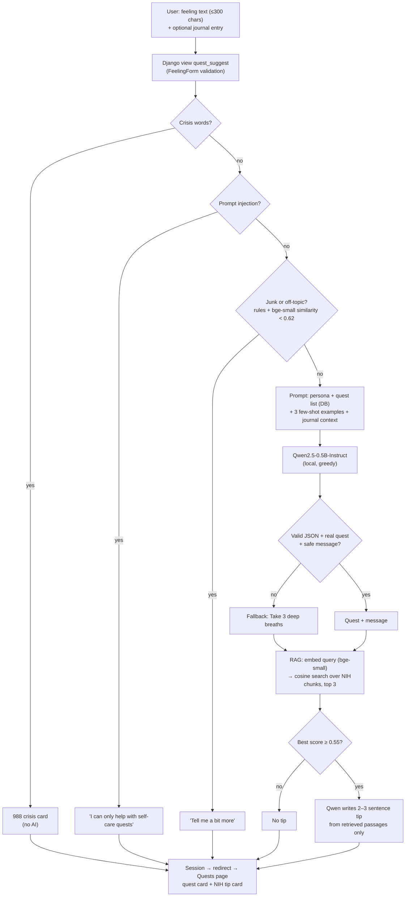

# Part 2 AI System Design Doc

**Feature:** "Ask SafeSpace" on the Quests page. The user writes how they feel → one quest from our DB + a kind message → a health tip from NIH articles (RAG).

## Flow
1. Input: feeling text (max 300 chars), plus an optional journal entry. If no entry is chosen, the 3 latest entries are added as background.
2. Preprocessing: Clean the text, then the crisis check (→ 988 message), the injection check, the junk rules, and the relevance check (bge-small similarity < 0.62 → "Tell me a bit more").
3. Prompt: persona, the quest list as JSON, 3 few-shot examples.
4. Model: Qwen2.5-0.5B-Instruct, greedy decoding.
5. RAG: bge-small embeds the input → top 3 NIH chunks; a best score < 0.55 means no tip → Qwen writes a 2–3 sentence tip from those chunks only.
6. Output checks: valid JSON, a real quest, a safe message. If any check fails, the fallback is "Take 3 deep breaths".
7. Final output: The result is saved in the session → redirect → quest card + tip card, shown once.

## Diagram

## Models
- `Qwen/Qwen2.5-0.5B-Instruct` (0.49B, ~1 GB): writes the quest pick and the tip
- `BAAI/bge-small-en-v1.5` (33M): embeddings for RAG and the relevance check
Both run locally, with no API key. Neither was fine-tuned. We used these instead of relying on a cloud service since the tasks we use them for are relatively small, making them a better fit than a larger model or cloud service. This also means we are not dependent on a cloud service that might fail, making our architecture simpler with less need for fallback options. 

## Links to earlier assignments
- **A6** (`ai_prototype.ipynb`): tested 15 models in 5 size groups. Chose Qwen2.5-0.5B for size, speed and few-shot results; few-shot was the best prompt style.
- **A7 P1** (`multi_model_system.ipynb`): 375 answers. Bigger models scored higher: Falcon3-3B 9.12, Llama-3.2-3B 9.8 on recommendation. Qwen2.5-0.5B was the fastest. We still kept the 0.5B model: it runs on a laptop CPU, and the code checks catch its mistakes.
- **A7 P2** (`A7_P2_S4.md`): our own tiny transformer was useless without fine-tuning, which is why the app uses a pretrained model.
- **A8** (`rag_system.ipynb`, `rag_analysis.md`): bge-small was as accurate as bge-large and about 3× faster.
- **Relevance threshold** (`relevance_check.py`): 0.62 kept 20/20 real feelings in both test sets, blocked 20/20 off-topic in the tuning set and 18/20 in the held-out set. Nothing was trained.
- The home-page welcome message is a separate feature that uses Gemini (`core/welcome.py`).
